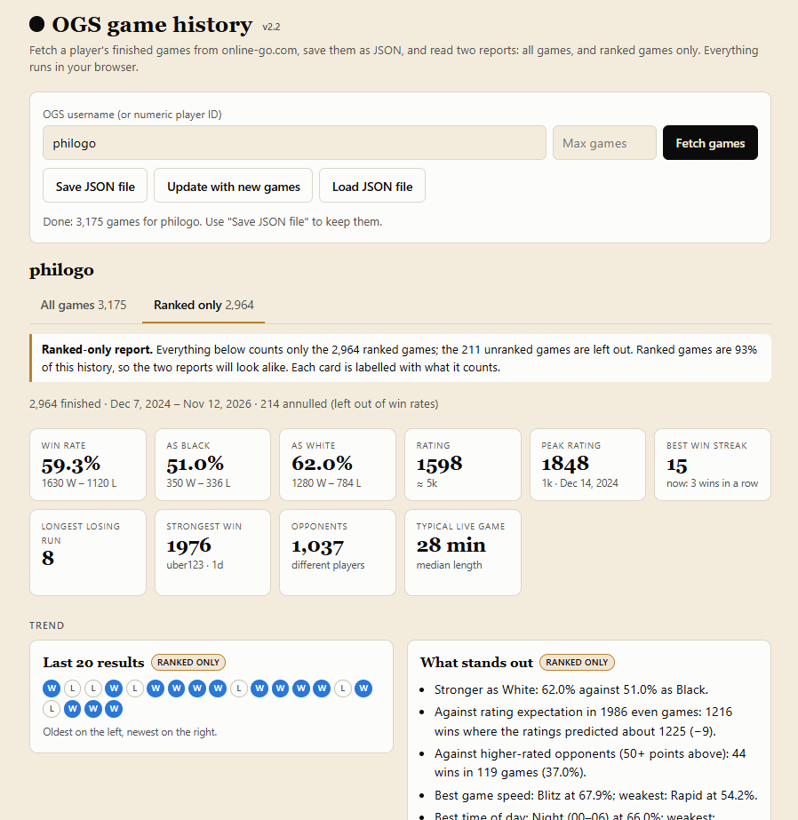
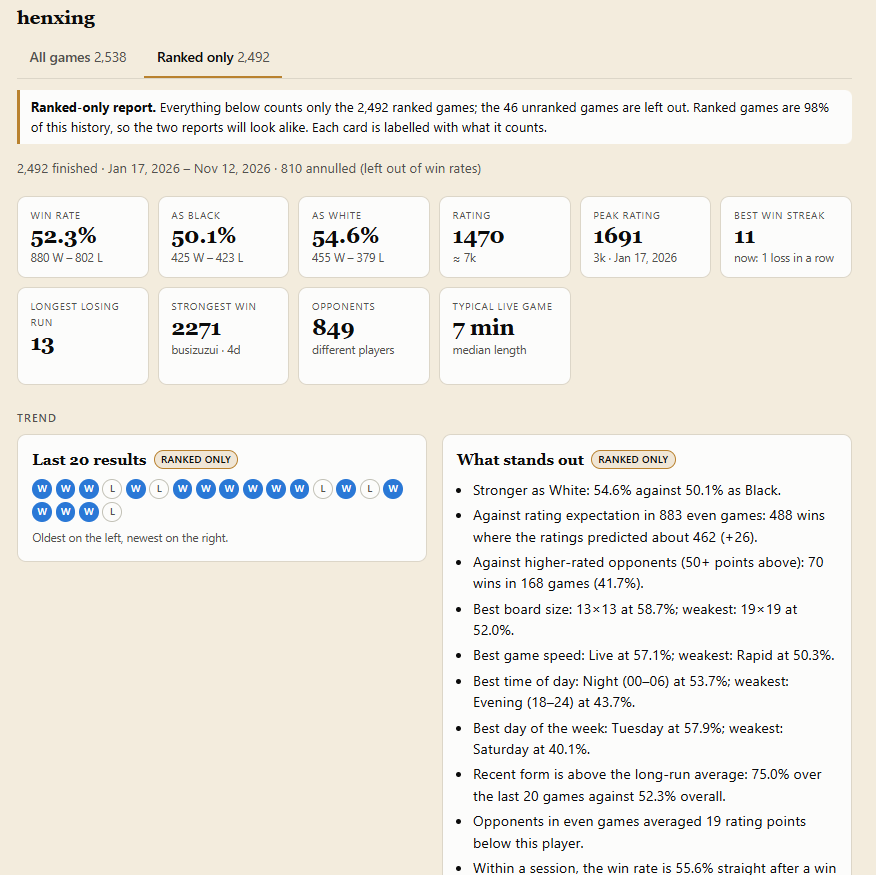

# OGS Game History

**Look up any [online-go.com](https://online-go.com) (OGS) player, download their whole game history, and get a statistics report, all in one static web page. No server, no install, no account.**

### ▶ [Try it live](https://thexqin.github.io/ogs-game-history/)

Built in one day through agentic coding with Claude: I set the goals, steered the design, questioned the results and decided what shipped. The agent researched the API, wrote the code, tested it and documented it.

| Fetch, save and summary | "What stands out" findings |
|---|---|
|  |  |

---

## What it does

1. **Fetch:** type an OGS username. The page pages through the public OGS API from your browser, politely (one request at a time, with backoff on HTTP 429).
2. **Save:** download the raw history as a JSON file. Next time, load the file instead of fetching again, and use **Update with new games** to pull only what's new (usually one request).
3. **Report:** two reports, **All games** and **Ranked only**, each with:
   - win rate overall, as Black, as White, ranked and unranked
   - a rating chart, rolling win rate and activity over time
   - results against stronger and weaker opponents, compared with an Elo-style expectation
   - board size, game speed, handicap and how games ended
   - sessions and momentum (results after a win, after a loss, after a losing run)
   - hour of day and day of week
   - notable games: biggest upset, strongest opponent beaten and more
   - a plain-language **"What stands out"** summary that ignores samples too small to mean anything

The whole app is one 56 KB HTML file: hand-written SVG charts, no libraries, no build step, light and dark themes, phone-friendly.

## How it was built: agentic coding

| | |
|---|---|
| **Agent** | Claude (Fable 5.2) for the build, Claude Code (Opus 5.5) for publishing |
| **My role** | Product owner and reviewer: set requirements, challenged claims, spotted unclear UX, decided scope |
| **Time** | v1 to v2.2 in one day, six prompts |
| **Process** | Prompt → agent researches, builds and verifies → I review and push back → next version ([`CHANGELOG.md`](CHANGELOG.md)) |

### The loop, version by version

| Version | What I asked or challenged | What came out |
|---|---|---|
| [v1](versions/ogs-history-v1.html) | "Can this be done in plain HTML, or do I need Node.js?" | The agent answered the architecture question first (plain HTML is enough), then built a working fetch, save and report page. It was honest that the live fetch was still untested. |
| [v2](versions/ogs-history-v2.html) | Separate ranked from all games, add deeper analysis, document everything | It checked the live API in a real browser and found the true field names, which corrected a wrong guess in v1. Two reports, interactive charts, rating-expectation analysis. Tested headless at desktop and phone widths. |
| [v2.1](versions/ogs-history-v2.1.html) | *"You can't run this in an artifact, so how did you verify it?"* and *"It's not clear which graphs show ranked games."* | It explained exactly what had and hadn't been tested, then ran the missing test (a `null`-origin fetch, which is what a local file makes). Added scope labels on every card, a scope banner and pinned tabs. |
| [v2.2](versions/ogs-history-v2.2.html) | Rate-limit and ban risk; "review the whole folder, add analysis" | Incremental update (to cut API load), provisional-rating filtering, small-sample flags, retries, sessions and momentum, notable games, and a full rewrite of the docs. |

### What I'd point to as the skill

- **Asking the architecture question before the feature question.** "Do I need a server?" shaped everything that followed.
- **Not accepting "verified" at face value.** Asking *how* it was verified exposed an untested path, which then got tested.
- **Reviewing as a user.** "Which graph is ranked?" was a UX problem no test would catch.
- **Thinking about the third party.** Asking about rate limits and bans led to polite pacing and the incremental-update feature.
- **Keeping a paper trail.** A changelog, archived versions and a verification table, so the work can be audited.

## How it was verified

| Check | How | Result |
|---|---|---|
| OGS endpoints respond and return the fields used | Read a live game record in a real browser | Passed |
| Another origin can call OGS (CORS) | `fetch` from a foreign origin and from a `null` origin; header check for `access-control-allow-origin: *` | Passed |
| Statistics code | Node.js against mock games | Passed |
| Paging, Max games, incremental update | Node.js with a stubbed network (250 games, 100 per page) | Exact counts in every case |
| Layout, charts, tooltips, both tabs | Headless Chrome with 900 mock games at 1100 px and 390 px | No script errors, no sideways overflow |
| Real use | Full fetches of real players with 2,500+ and 3,100+ games | Shown in the screenshots |

---

## Using it

**Online:** open the [live page](https://thexqin.github.io/ogs-game-history/).
**Offline:** download `index.html` and double-click it. It works from a local file too.

1. Enter an OGS username (or numeric player ID) and press **Fetch games**. **Max games** limits the fetch to the most recent N.
2. Press **Save JSON file** to keep the history.
3. Later, press **Load JSON file** to rebuild the report instantly, then **Update with new games**.
4. Switch between **All games** and **Ranked only**. Hover over (or tap) a chart for exact values.

Everything runs in your browser. Requests go straight from you to online-go.com, and saved files stay on your computer.

## How each figure is calculated

- **Decided game:** one player lost and the other did not. Annulled games are counted in totals but left out of win rates. Rengo (team) games are skipped.
- **Win rate:** wins ÷ decided games. Rows with fewer than 15 decided games are faded, and the findings never mention them.
- **Rating:** OGS's stored `historical_ratings` at each game. Rating figures use ranked games only, because unranked games don't change the rating.
- **Rank from rating:** `rank = ln(rating / 525) × 23.15`. Below 30 is kyu (`30 − rank`); 30 and above is dan.
- **Expected win rate:** `1 / (1 + 10^((opp − me) / 400))`, an Elo-style estimate. OGS itself uses Glicko-2, so treat it as a rough guide. Only even games count, where both ratings are known and the opponent's rating deviation is ≤ 160 (not provisional).
- **Session:** real-time games where each starts within 60 minutes of the previous one ending.
- **Time of day and weekday:** the viewer's local time, real-time games only.

## APIs used

OGS REST API (`https://online-go.com/api/v1`), unauthenticated `GET` requests only:

| Call | Purpose |
|---|---|
| `/players/?username=<name>` | Username → player ID |
| `/players/<id>/` | Player ID → username |
| `/players/<id>/games/?page_size=100&ordering=-ended&ended__isnull=false` | Finished games, newest first, paged |

Rate limits: OGS throttles with HTTP 429 and publishes no figures. The page sends one request at a time, 350 ms apart, waits and retries on 429 (5 s, 10 s, … up to six tries), and retries 502–504 three times.

## Code layout

Everything is in [`index.html`](index.html): one `<style>` block and one `<script>` block in five parts.

| Part | Functions | Job |
|---|---|---|
| 1. Fetch | `getJSON`, `resolvePlayer`, `fetchGames` | Pacing, retries, paging, incremental update |
| 2. Parse | `readDataset`, `normalise` | Raw OGS record → small per-game object |
| 3. Analyse | `analyse`, `insights` | Every number in the report, for one scope |
| 4. Render | `tile`, `card`, `breakdown`, `lineChart`, `stackedBars`, `render` | HTML and inline SVG |
| 5. Wiring | `init` | Buttons, tabs, tooltips, resize |

## Design decisions

- **Plain static HTML.** OGS allows cross-origin requests, so no backend is needed, and the page can be hosted on GitHub Pages as is.
- **Fetching and analysis are joined only by the JSON file.** The report is built from the dataset whether it came from the network or from disk, and raw records are kept so future versions can compute new statistics from old files.
- **One pipeline, two reports.** Games are normalised once and filtered per tab, so the two reports can't drift apart.
- **Scope is always visible**, and **small samples are flagged rather than hidden**.
- **Updates are all-or-nothing.** A partial merge would leave a gap that later updates could never fill.
- **Untrusted text is escaped.** Usernames and outcomes from the API are HTML-escaped.

## Known limits

- Very long histories take minutes to fetch.
- The OGS list endpoints may stop at 100 pages (10,000 games). Not confirmed.
- Correspondence games are left out of session and time-of-day analysis.

## Repository contents

| Path | What it is |
|---|---|
| `index.html` | The app (v2.2), served by GitHub Pages |
| `versions/` | Every released version, v1 to v2.2, each still runnable |
| `CHANGELOG.md` | What changed in each version, and how it was checked |
| `screenshots/` | Images used in this README |

---

*Not affiliated with OGS. Uses OGS's public API. Please be gentle with it.*
